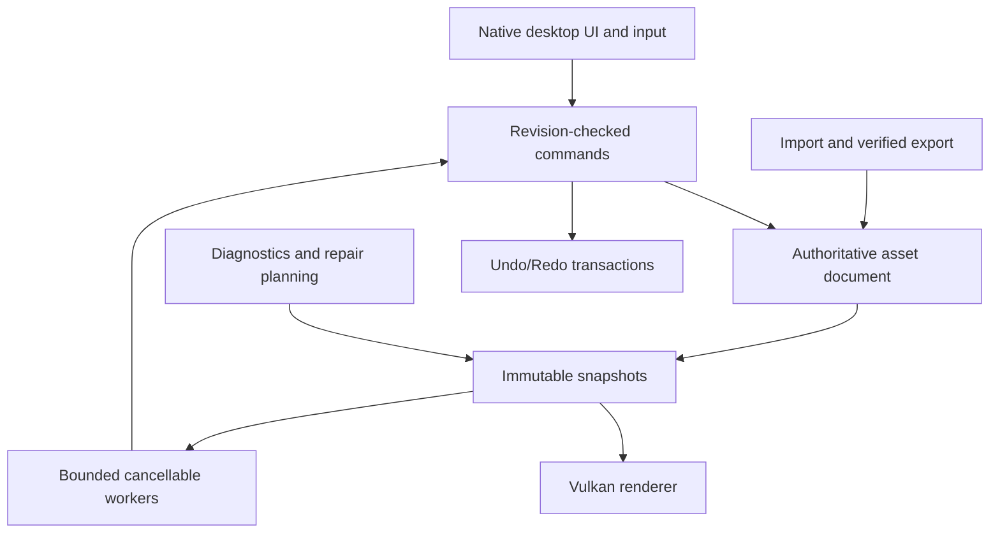

# Independent architecture

This is a new design based on product requirements. Legacy structure is rejected.
No old controller, viewer graph, worker protocol, source-patch implementation,
storage key or frontend component becomes a new module contract.

The diagram is a logical target, not all existing crates. Present workspace has
ad-document (immutable domain data/snapshot), ad-formats (bounded GLB parsing),
ad-render-vulkan (GPU lifetime/presentation/geometry) and ad-desktop (window,
input/camera, native dialogs and one bounded import worker).
Renderer accepts raw-handle targets retained by Arc; it does not import winit.
Desktop prepares egui paint primitives/texture deltas and a physical scene rectangle;
Vulkan's replaceable UI painter consumes that frame in the same submission as
geometry. Widgets, hierarchy selection and platform events remain desktop-owned.
Only ad-document defines authoritative asset data; desktop owns the current
document and swaps it after candidate GPU upload succeeds. Renderer owns GPU
buffers/draw ranges, never the source document. Formats/document import no UI
or GPU crates. See ADR-0013 for the implemented static subset.
Add a crate only when its independent boundary is implemented and justified.

ADR-0015 adds shared independent image/sampler data to the document's renderable
subset. Formats decode admitted in-memory PNG/JPEG resources; snapshots share
pixels across instances and carry UV/linear-color arrays. Vulkan owns image/mip,
sampler and descriptor resources only. Candidate upload is transactional and never
changes document bytes. Base-color sampling is presentation state, not an edit.

The owner's advisory v0.1 proposal was reviewed in
ARCHITECTURE_PROPOSAL_REVIEW.md. Session history and revision-keyed findings are
application/derived state, not fields that every saved asset must embed. Compare
uses one document/session inventory, not an independent editing architecture.

Coordinate/ID/source-preservation contracts are accepted for the static subset in
ADR-0002/ADR-0013; general materials, editing/history and export remain open.
Renderer consumes immutable snapshots keyed by document identity/revision. GPU
handles and presentation normalization never live in document data. UI emits
commands; workers return candidate results with version, progress and cancel state.
Only command commit may mutate authoritative data. Export and persistence are
separate from viewport state. There is one scene inventory and one command history.

Manual baseline rig/animation editing is distinct from late autorig/retargeting.
No Mixamo content is bundled before its redistribution rights are established.
