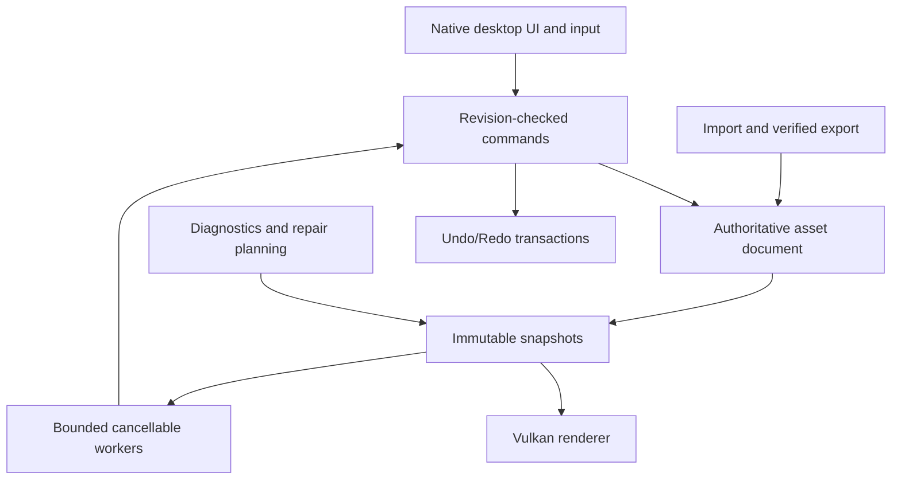

# Independent architecture

This is a new design based on product requirements. Legacy structure is rejected.
No old controller, viewer graph, worker protocol, source-patch implementation,
storage key or frontend component becomes a new module contract.

The diagram is a logical target, not existing crates. Present workspace has only
ad-render-vulkan: a replaceable device experiment that owns no asset/document data.
Add a crate only when its independent boundary is implemented and justified.

The owner's advisory v0.1 proposal was reviewed in
ARCHITECTURE_PROPOSAL_REVIEW.md. Session history and revision-keyed findings are
application/derived state, not fields that every saved asset must embed. Compare
uses one document/session inventory, not an independent editing architecture.

Coordinate/ID/material/source-preservation contracts are proposals in ADR-0002.
Renderer consumes immutable snapshots keyed by document identity/revision. GPU
handles and presentation normalization never live in document data. UI emits
commands; workers return candidate results with version, progress and cancel state.
Only command commit may mutate authoritative data. Export and persistence are
separate from viewport state. There is one scene inventory and one command history.

Manual baseline rig/animation editing is distinct from late autorig/retargeting.
No Mixamo content is bundled before its redistribution rights are established.
