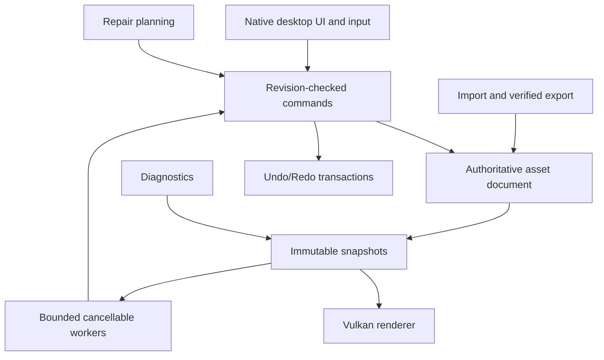

# Independent architecture

This is a new design based on product requirements. Legacy structure is rejected.
No old controller, viewer graph, worker protocol, source-patch implementation,
storage key or frontend component becomes a new module contract.

The diagram is a logical target, not all existing crates. Present workspace has
ad-document (authoritative domain data/snapshot), ad-formats (bounded GLB import
and verified static export), ad-render-vulkan (GPU lifetime/presentation/geometry),
ad-analysis (read-only source geometry findings), ad-commands (bounded index history),
ad-storage (Windows new-path verified file IO), ad-heal (complete oriented duplicate
planning) and ad-desktop (window, input/camera,
native dialogs and one bounded import worker). Commands/heal/storage are internal APIs;
desktop still owns a read-only viewer workflow.
Renderer accepts raw-handle targets retained by Arc; it does not import winit.
Desktop prepares egui paint primitives/texture deltas and a physical scene rectangle;
Vulkan's replaceable UI painter consumes that frame in the same submission as
geometry. Widgets, hierarchy selection and platform events remain desktop-owned.
Only ad-document defines authoritative asset data; desktop owns the current
document and swaps it after candidate GPU upload succeeds. Renderer owns GPU
buffers/draw ranges, never the source document. Formats/document import no UI
or GPU crates. See ADR-0013 for the implemented static subset.
Add a crate only when its independent boundary is implemented and justified.

ADR-0015 adds shared independent image/sampler data to the document's renderable
subset. Formats decode admitted in-memory PNG/JPEG resources; snapshots share
pixels across instances and carry UV/linear-color arrays. Vulkan owns image/mip,
sampler and descriptor resources only. Candidate upload is transactional and never
changes document bytes. Base-color sampling is presentation state, not an edit.

ADR-0016 preserves optional source normals and metallic/roughness factors. The
snapshot derives world normals independently with inverse-transpose; a zero
sentinel requests geometric fallback. Session lighting mode/exposure/intensities
stay outside the document. Vulkan consumes four plain vertex streams and a128-byte
camera/material/light push block. These settings neither edit materials nor create
scene lamps; editable lamps and general lighting contracts remain future work.

ADR-0017 adds a second material channel with its own UV stream. Generic Texture
keeps decoded image and sampler identity independent of use; admission distinguishes
SRGB/linear sampled variants while retaining one CPU pixel allocation per image.
GPU owns separate format uploads and two compatible descriptor sets per draw.
Session MR sampling is independent of color sampling. Geometry admission56bytes
per vertex includes both UV streams; prospective mip budgets include both formats.

ADR-0018 adds source tangent/normal-map data, a third UV stream and derived world
tangents. Domain geometry stays plain arrays. Linear MR/normal images share the
same upload when source identity agrees; a third compatible descriptor set binds
the normal role. Seven GPU streams total80bytes/vertex. Authored frame derivation
is CPU-side; a bounded non-Mikk derivative fallback is isolated in the shader.
The source scale uses the spare material push slot, retaining the128-byte budget.

ADR-0019 adds independent AO UV/strength/texture and an88-byte vertex budget. AO
reuses linear image ownership and applies only to inspection fill. Four compatible
descriptor sets consume Vulkan's guaranteed minimum; emission must first redesign
camera/material binding rather than adding a fifth set or exceeding128-byte push.

ADR-0020 supersedes the per-channel binding layout: one96-byte frame uniform set
and one deduplicated whole-material texture set, with64-byte per-draw push. Frame
buffer writes only follow single-frame fence retirement. Up to4096unique texture
tuples are admitted before image/pool allocation; source factors can share tuples.
This leaves baseline Vulkan capacity for emission without descriptor indexing.

ADR-0021 adds core emission factor and SRGB map with independent UV. The fifth
material channel stays in set1, sharing base SRGB upload where identities agree.
Geometry admission is96bytes/vertex; frame96/push64 and tuple4096caps are unchanged.
Emission adds before exposure in PBR only, independent of AO and key/fill.

The owner's advisory v0.1 proposal was reviewed in
ARCHITECTURE_PROPOSAL_REVIEW.md. Session history and revision-keyed findings are
application/derived state, not fields that every saved asset must embed. Compare
uses one document/session inventory, not an independent editing architecture.

Coordinate/ID/source-preservation contracts are accepted for the static subset in
ADR-0002/ADR-0013; general materials, editing/history and export remain open.
Renderer consumes immutable snapshots keyed by document identity/revision. GPU
handles and presentation normalization never live in document data. UI emits
commands; workers return candidate results with version, progress and cancel state.
Only command commit may mutate authoritative data. Export and persistence are
separate from viewport state. There is one scene inventory and one command history.

Manual baseline rig/animation editing is distinct from late autorig/retargeting.
No Mixamo content is bundled before its redistribution rights are established.

ADR-0022 implements ad-analysis as a read-only dependent of ad-document. Findings
refer to document-local source primitives and indices, tagged by ID/revision and
algorithm. The bounded import worker computes them before publication; an analysis
budget failure is retained as incomplete status alongside the viewable asset. UI
never replaces stale/incomplete evidence with a healthy result. Current source
checks use robust adaptive predicates and bounded sorting/samples, no renderer data.

ADR-0023 extends analysis to indexed edge incidence. Core primitive buffers are
released before per-primitive12byte edge records are admitted/sorted. Version3
reports use typed scalar-index or vertex-pair samples. Fixed per-rule coverage
retains completed/omitted/excluded scope and up to16omitted IDs without allocation
on failure. Resource-limited edge checks preserve completed core findings; whole-
job cancellation still discards publication. No welding or full manifoldness claim.

ADR-0024 adds an independent source-index component phase after edge storage
retires. A disjoint-set forest uses3u32arrays per source vertex; consuming its
summary reuses member counts as visited-root markers. No adjacency graph or
per-component allocation is retained. Algorithm4 adds typed minimum-index/member/
triangle summaries and G008coverage, including after edge-resource refusal.
Connectivity is through shared vertex indices, not positional welding, edge-only
surface connectivity or physical-part identification.

ADR-0025's data increment replaces authoritative per-material-role UV arrays with
up to8sorted source TEXCOORD_n channels and explicit role-selected channel IDs.
Unselected channels are preserved and validated; decoded admission accounts for
their storage before allocation. Snapshot/GPU still derives the five role streams
at96bytes/vertex. Algorithm5 now executes G009/G010/G011 over this inventory with
fixed8channel stack tallies, bounded typed evidence and atomic per-primitive/rule
multichannel output. Coverage distinguishes checked/not-applicable/omitted scope;
cooperative cancellation discards partial tallies. No UV working allocation scales
with vertex/triangle count. Full UV quality/repair remains outside this subset.
Current implemented/planned boundaries: MASTER_PLAN_AND_STATUS_RU.md.

ADR-0026adds ad-commands as the application-side owner of one fresh-import document
and bounded linear index-command history. Only ad-document is a runtime dependency;
no graphics, OS/file IO or repair planner. The document owns private monotonic
revision/origin and validated triangle-removal/exchange operations; history owns
alternate index Vecs and state/cursor. All attributes/source/images remain shared
without whole-document clones. Entry/payload admission precedes mutation; failed
branches/no-ops retain redo. Read-only snapshots now carry current revision.
This internal CPU boundary does not implement desktop edit publication or generic
geometry/rig history. Full first-Heal publication remains open in ADR-0027.

ADR-0028 adds pure static export inside formats: shared source preflight, stable
source-primitive binding, append-only index storage and an independently reimported/
compared VerifiedGlb. Unchanged bytes copy exactly; changed opaque metadata is
refused. ADR-0029 adds ad-storage with a private saved receipt, same-directory
exclusive staging, full disk readback and hard-link no-replace publication.
Windows handle-bound deletion owns cleanup; publication is the commit point.
Both proof and receipt retain origin/revision identity. Filesystem IO stays outside
document, commands, analysis and renderer. No Save UI or saved-state clearing exists.
See STATIC_EXPORT_REPORT_2026-11-16.md for tested subsets and memory/filesystem limits.

ADR-0030 adds a complete single-source-primitive duplicate plan in ad-heal. It owns
no diagnostic report, graphics or file IO; document/commands are its only runtime
dependencies. A private origin/revision plan retains all removal ordinals, counts
source-node references and prepares through existing history admission. Guarded
immutable candidate indices permit independent deletion/coverage/earliest-survivor
verification before the command is returned. Source/material/export eligibility
and atomic native document/history/analysis/snapshot/GPU publication remain open.
No second history or UI repair controller is introduced. Evidence and limits:
DUPLICATE_PLAN_REPORT_2026-11-17.md.
